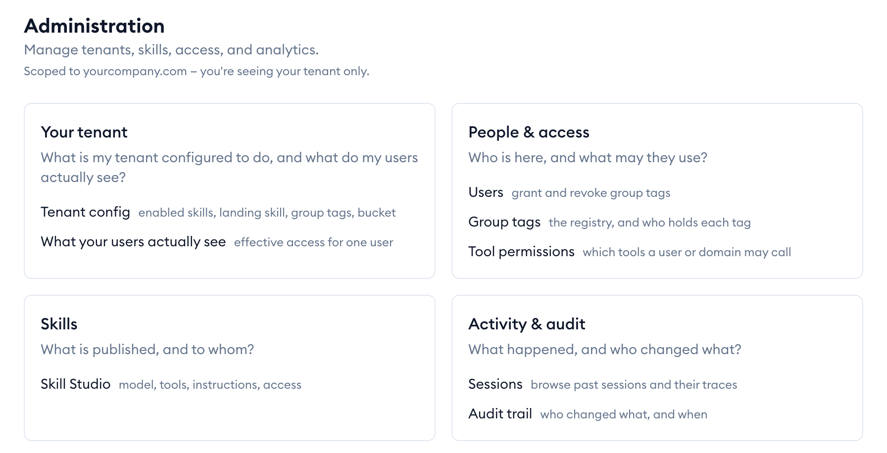
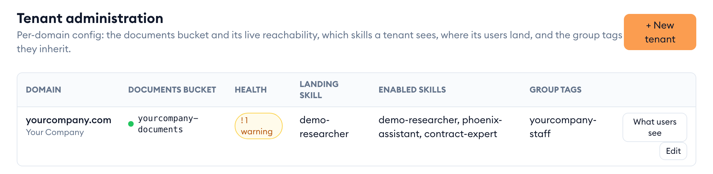
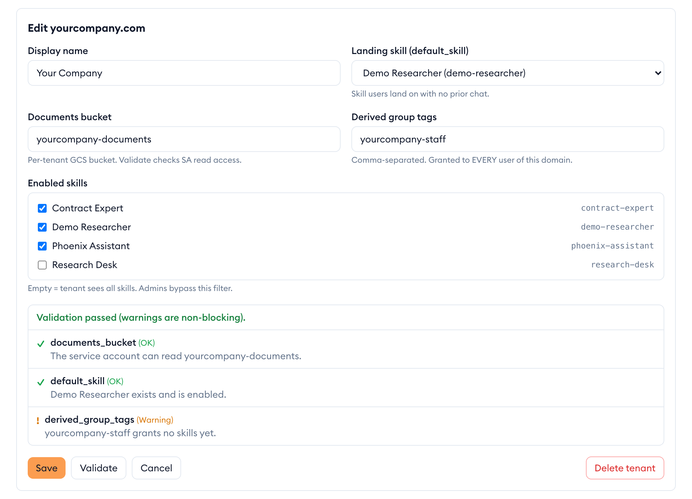
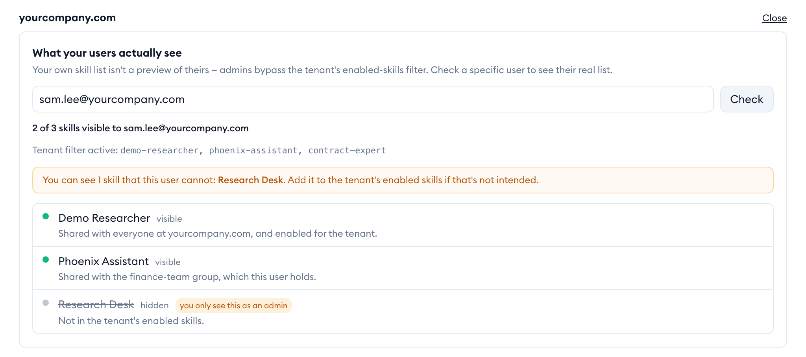
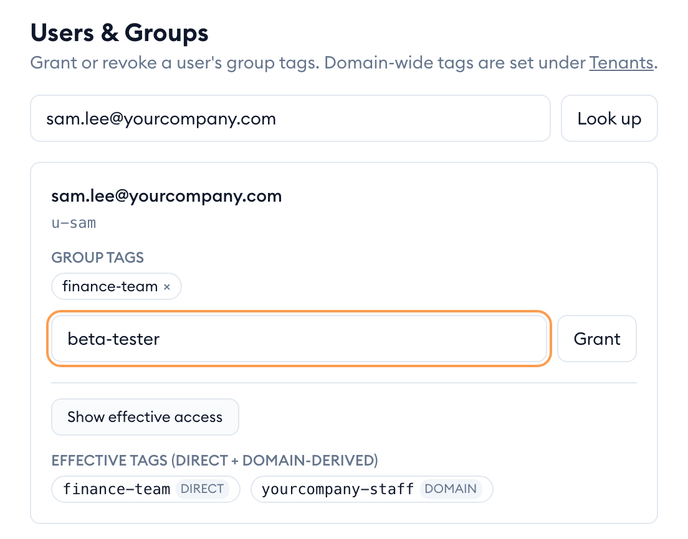
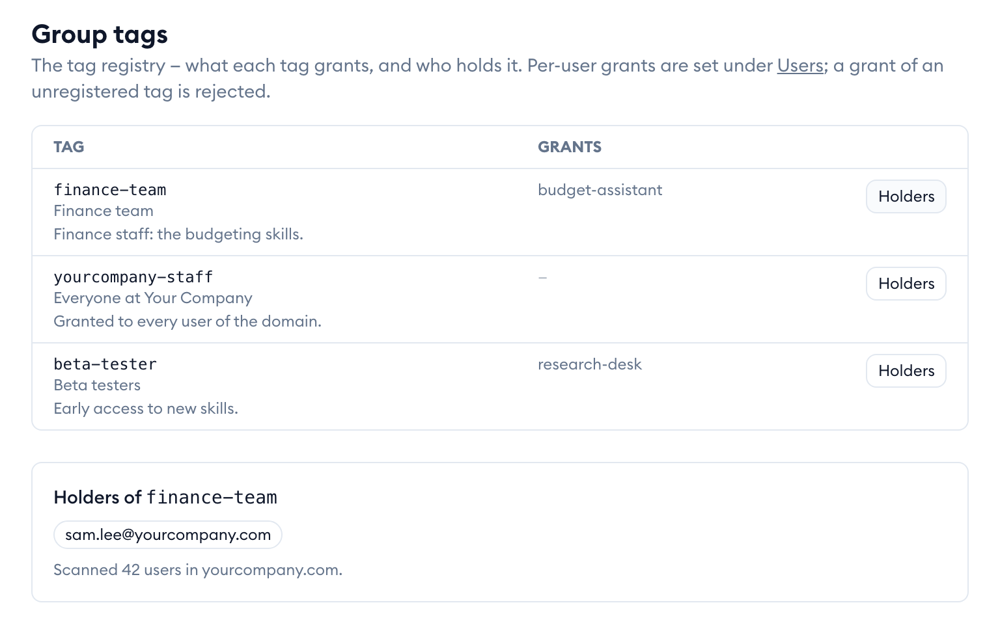
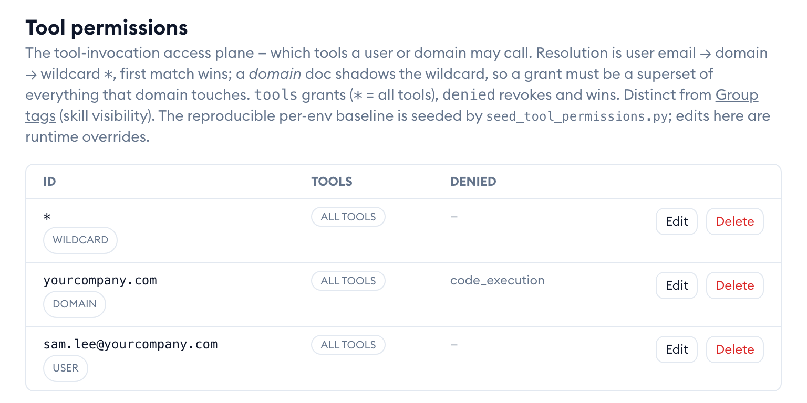
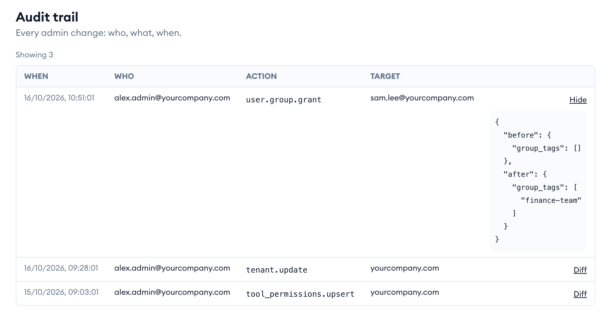

The admin area is for two kinds of admin. A *workspace admin* looks after one organisation (one email domain, called a *tenant*) and only ever sees that tenant's people and settings. A *platform admin* looks after every tenant on {{appName}}, and also sees the platform-wide settings.

## Open the admin area

1. Click your avatar at the top right, then **Admin**. The item only appears if you are an admin.
2. The home page groups everything by the question it answers: your tenant, people and access, skills, and activity.

If you are a workspace admin, a line under the title says which domain you're scoped to — a short list means "your tenant only", not that the platform is empty.

> [!TIP]
> **Just been made an admin and see "Admins only"?** A new group tag only arrives when your sign-in refreshes. Click **Re-check my access** on that page instead of waiting.

## Configure your tenant

The tenant page holds the settings for your domain: where its documents are stored, which skills its people may use, the skill they land on, and the group tags everyone in the domain gets.

1. On the admin home, click **Tenant config**.
2. The table shows each tenant with a health badge. A warning or "needs fix" badge means a check failed — the editor tells you which.
3. Click **Edit** on your tenant. You can change:
   - **Display name** — the organisation's name.
   - **Landing skill (default_skill)** — the skill people start on when they have no earlier chat.
   - **Documents bucket** — where the tenant's uploads are stored.
   - **Derived group tags** — tags granted to *every* user of the domain.
   - **Enabled skills** — tick the skills your people may use. Leave all unticked and they see every skill they have access to.
4. Click **Validate** to check the settings without saving, then **Save**.

Validation lists each check. Warnings don't block a save; errors do.

> [!WARNING]
> **Delete tenant** removes the tenant's configuration. Its people lose the tenant's settings at their next sign-in.

## Check what your users actually see

As an admin you see every skill, even ones your tenant hides, so your own skill list is not a preview of theirs. To see one person's real list:

1. On the tenant page, click **What users see** on the tenant.
2. Type the person's email and click **Check**.
3. You get their skill list: a green dot for each skill they can open, and for each hidden one, the reason it's hidden.

If you can see a skill they can't, an amber note names it. Add it to the tenant's **Enabled skills** if they should have it.

## Grant or revoke a person's group tags

Group tags decide which shared skills and folders a person can use. To change one person's tags:

1. On the admin home, click **Users**.
2. Type their email and click **Look up**.
3. To add a tag, type it and click **Grant**. To remove one, click **×** on the tag.
4. Click **Show effective access** to see every tag they hold, and where each comes from: given to them directly, or inherited from the domain.

A change takes effect the next time that person's sign-in refreshes — usually within the hour, or immediately if they sign out and back in.

> [!NOTE]
> Workspace admins can grant tags to people in their own domain only, and only a platform admin can grant a tag that makes someone an admin.

## See what each group tag grants

Platform admins keep a registry of group tags: what each one is for and what it grants. A tag must be registered before anyone can be given it.

1. On the admin home, click **Group tags**.
2. Each row shows the tag, its description and what it grants.
3. Click **Holders** to see who holds that tag directly.
4. To add or change a tag, fill in the form below the table and click **Save tag**.

## Control which tools people may use

Tool permissions decide which tools — web search, code execution, document reading and so on — a skill may use on someone's behalf. They're separate from which skills a person can see.

1. On the admin home, click **Tool permissions**.
2. Each row applies to one person (by email), one domain, or everyone (`*`). The most specific row wins: a person's row, then their domain's, then everyone's.
3. **Tools** lists what's allowed (all tools, or a list); **Denied** removes tools and always wins.
4. Click **Edit** to change a row, or use the form below the table and click **Save doc**. **Delete** removes a row.

> [!WARNING]
> A domain row replaces the everyone row for that domain entirely, so it must allow every tool that domain's skills use.

## Read the audit trail

Every admin change is recorded: who made it, what it was, what it applied to, and when.

1. On the admin home, click **Audit trail**.
2. Click **Diff** on a row to see exactly what changed, before and after.

Workspace admins see their own tenant's changes only.

