Every document you upload is read once and kept in your library under **Your files** → **My Documents**, so you can come back to it in any chat. This page is about single documents; to upload or organise many at once, see [Working with folders](folders.md#upload-a-whole-folder).

## Upload a document

There are two places to upload from.

- **On a new chat:** under *Or start from a document*, drop files onto **Drop files here or click to browse**, or click it to pick files. The document opens beside the chat as soon as it's read, ready to ask about.
- **While chatting:** click **+** in the message box (**Attach a document**) and pick a file.

Supported types include PDF, Word, PowerPoint, Excel, OpenDocument, EPUB, email (EML, MBOX), HTML, Markdown, CSV and plain text. You can upload several files at once.

A file uploaded on its own goes into a folder named for the day, such as `Uploads 2026-10-16`. You can [move it](folders.md#move-documents-between-folders) afterwards.

> [!TIP]
> Uploading the same file into the same folder again replaces the old copy rather than adding a second one.

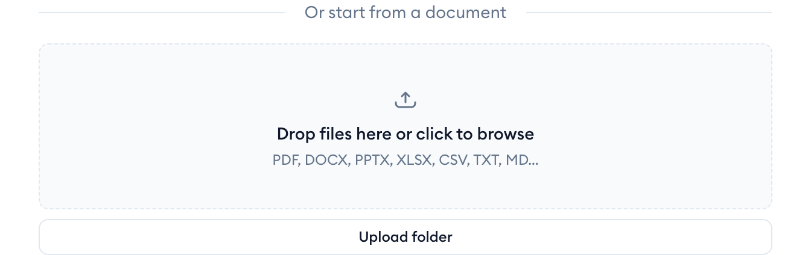
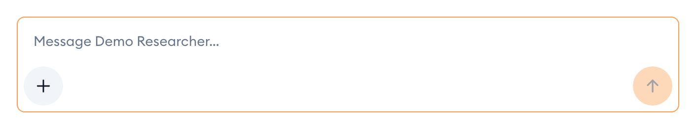

## Check a document is ready

{{appName}} reads each document before it can be used. The dot beside its name shows where it's up to:

- *Green*: read and ready.
- *Amber, pulsing*: still being read. A progress bar under the folder list counts how many are done.
- *Red*: it couldn't be read. The reason is shown under the name, for example a scanned PDF with no text in it.

For a red document, click **Retry** to read it again. If it fails again, the file itself is the problem: export it again from the program that made it, or for a scan, use a version with selectable text.

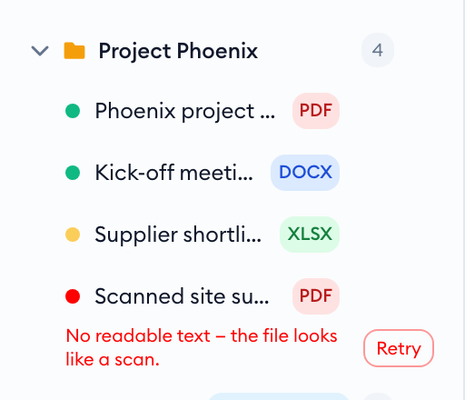

## Open a document

Click a document's name in the sidebar. It opens in the **Document** tab beside the chat, and a tab for it appears above the sidebar. Hover over a name to see a quick preview without opening it.

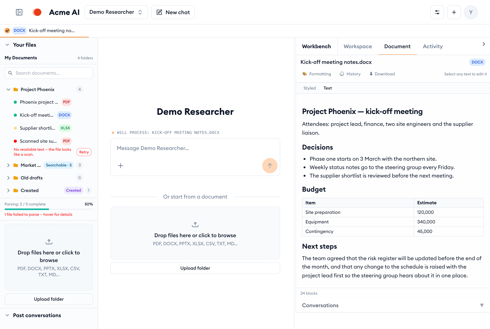

The document has two views:

- **Styled** shows it as it looks, with its fonts and layout.
- **Text** shows its plain structure: headings, lists and tables. This is what the assistant reads.

## Ask about a document

An open document is part of the conversation: above the message box you'll see **Will process:** and its name. Ask your question as normal, for example "Summarise the decisions" or "What's the contingency in the budget?".

Each open document has a checkbox on its tab:

- *Ticked*: the assistant reads it on your next message.
- *Unticked*: it stays open for you to look at, but the assistant leaves it out.

Close a tab with the **×** that appears when you hover over it. The document stays in your library.

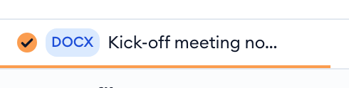

## Edit a passage

You can ask for a change to one part of a document without regenerating the rest.

1. In the open document, select the text you want changed. A small box opens beside it.
2. Say what should change, for example "Make it shorter and clearer".
3. Click **Rewrite**.

Only the passage you selected is rewritten; everything else stays as it was. Each edit is saved as a new version, so you can go back (see the next section).

> [!NOTE]
> A scanned document, or one with no readable text, can't be edited this way.

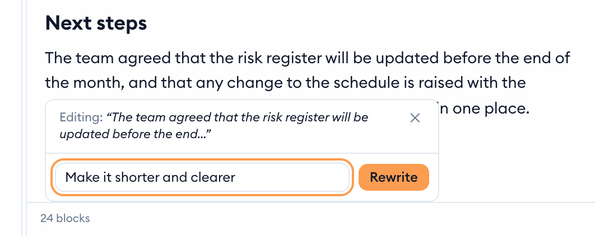

## Download it or bring back an earlier version

Above an open document:

- **Download** saves the file to your computer.
- **History** lists earlier versions. The one you're looking at is marked *on screen*. Click an older version to bring it back. Nothing is lost: restoring adds a new version.
- **Formatting** restyles the document from a template, for example your organisation's letterhead.

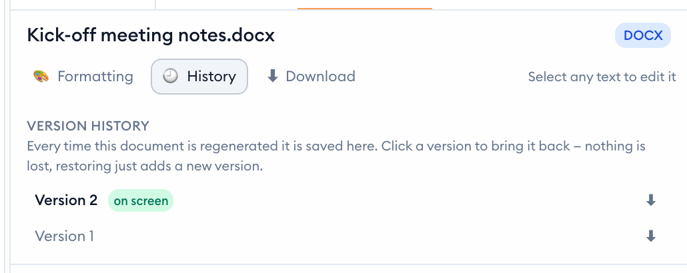

## Rename a document

Each document has a **⋯** menu. It appears when you hover over the document in the sidebar.

1. Hover over the document and click **⋯**, then **Rename**.
2. Type the new name in place.
3. Press `Enter` to save, or `Esc` to cancel.

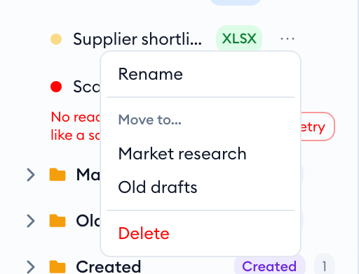
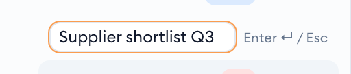

The document keeps its file type: if you leave the ending off, such as `.pdf`, it's added back for you. Two documents in the same folder can't share a name. If you pick a name that's taken, you'll see a message and the document keeps its old name.

## Delete a document

1. Hover over the document in the sidebar.
2. Click the bin icon, or click **⋯**, then **Delete**.
3. {{appName}} asks you to confirm, naming the document. Click **Delete** to remove it, or **Cancel** to keep it.

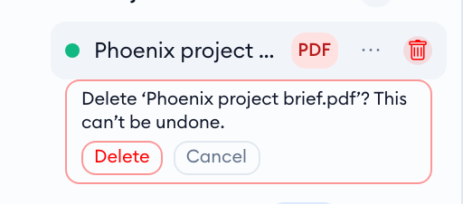

The document is removed from your library and from any folder search it was part of. This can't be undone.

## Documents the assistant creates for you

When you ask for a report, a letter or a summary as a document, the assistant saves it in the **Created** folder and opens it beside the chat. These documents carry a **Created** label. You can open, edit, download and ask about them like any other document.

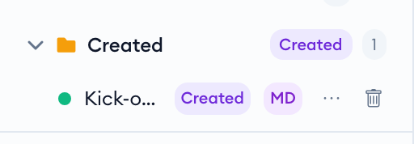
