Your folders live in the sidebar under **Your files** → **My Documents**. Open the sidebar with the panel button at the top left.

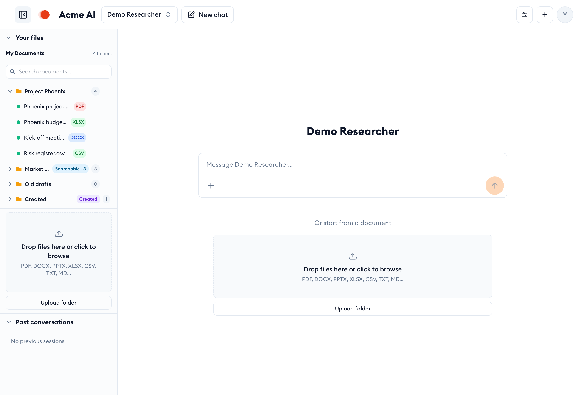

## Upload a whole folder

Send a folder from your computer and its files arrive in a folder of the same name. You don't have to create the folder first.

1. In **My Documents**, click **Upload folder** below the drop area.
2. Pick the folder on your computer and confirm. Your browser may ask whether to upload all its files. Say yes.
3. Or drag the folder from your desktop straight onto the drop area.

Files upload three at a time, and a progress bar shows how far along it is.

> [!NOTE]
> **Subfolders are kept.** A file in `Quarterly reports/2026/` goes into a folder called `Quarterly reports/2026`.

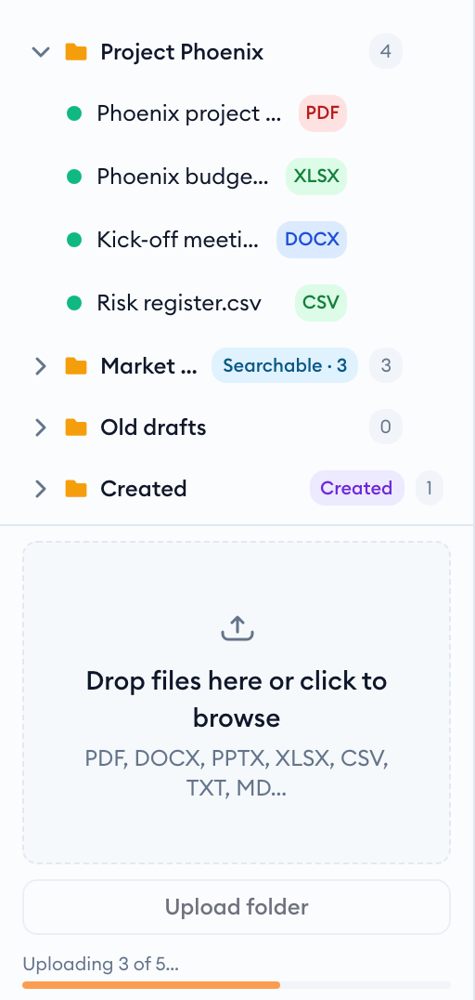

### Read the summary

When it finishes, a one-line summary tells you what happened to every file:

- **uploaded**: new or changed files, now in the folder.
- **unchanged**: a file identical to one already in that folder. It's skipped, so uploading the same folder again only sends what changed.
- **skipped (not supported)**: hidden files like `.DS_Store`, and file types the library can't read.
- **failed**: listed by name with the reason, so you can retry those files.

Supported types: PDF, Word, PowerPoint, Excel, OpenDocument, EPUB, email (EML, MBOX), HTML, Markdown, CSV, plain text, PNG/JPEG images and LaTeX. Close the summary with **×**.

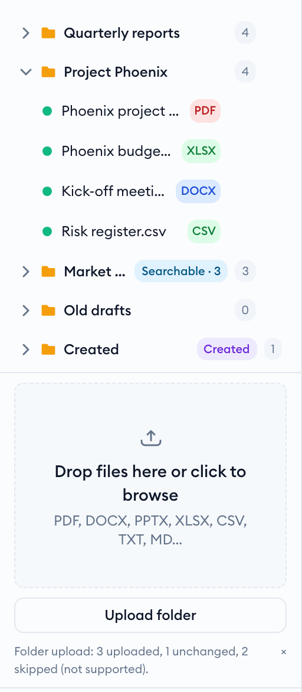

## Rename a folder

Each folder you own has a **⋯** menu. It appears when you hover over the folder row.

1. Hover over the folder and click **⋯**, then **Rename**.
2. Type the new name in place.
3. Press `Enter` to save, or `Esc` to cancel.

Two of your folders can't share a name. If you pick a name that's taken, you'll see a message and the folder keeps its old name.

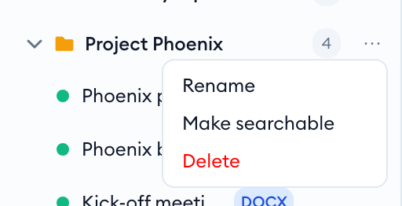
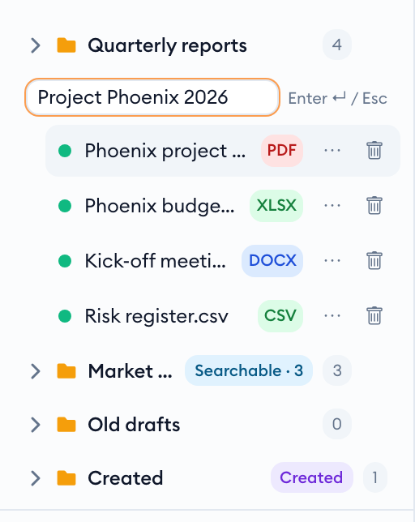

## Delete a folder

Only empty folders can be deleted, so you can never lose documents by deleting their folder.

1. Click **⋯** on the folder, then **Delete**.
2. Confirm with **Delete**, or click **Cancel**.

If the folder still has documents, nothing is deleted. A red message tells you how many are left: move or delete them first, then try again.

> [!NOTE]
> The **Created** folder holds documents the assistant made for you. It's managed for you and has no menu.

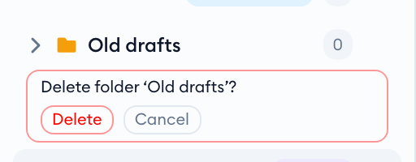
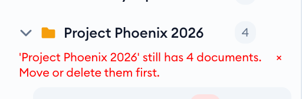

## Move documents between folders

There are two ways to move a document: from its menu or by dragging it.

- **From the document menu:** open a folder, hover over a document, click its **⋯** and choose a folder under **Move to…**
- **By dragging:** drag a document row onto another folder. The folder is outlined while you're over it. Let go to move the document there.

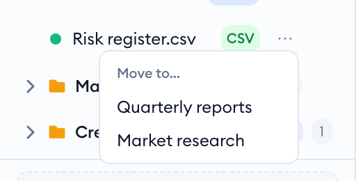
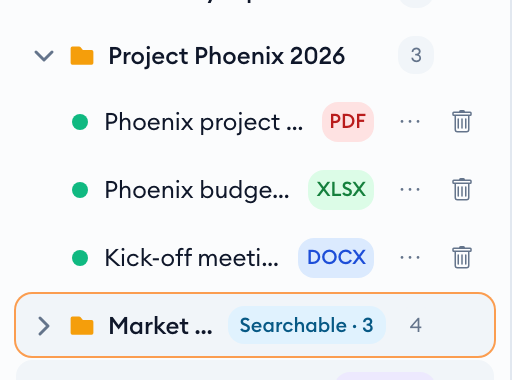

### When the name is already taken

If the target folder already has a document with the same file name, you're asked first:

- **Replace** moves your document and removes the one that was there.
- **Cancel** leaves both documents where they are.

There's no "keep both" option. To keep both, rename one of the files and upload it again.

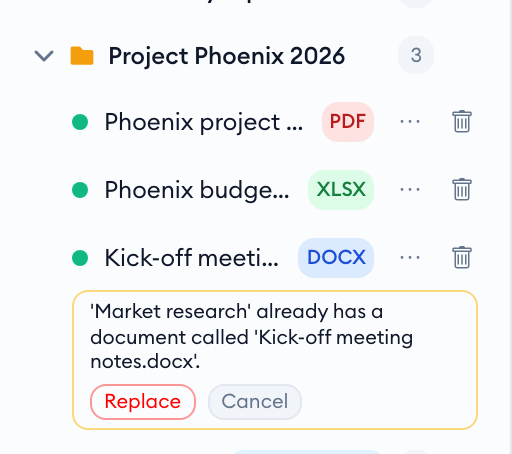

## Make a folder searchable

A searchable folder becomes a knowledge base: a skill can search its contents and cite the documents it used.

1. Click **⋯** on the folder, then **Make searchable**.
2. Indexing starts in the background. The badge counts up, for example **Indexing 1/2**.
3. When it's done, the badge reads **Searchable · 2**, the number of documents that can be searched.

It stays up to date on its own. New uploads, moves in or out, and deletions are reflected automatically. At first, only you can search it. Hover over the badge to see details, including any documents that couldn't be indexed.

> [!NOTE]
> You'll only see **Make searchable** where knowledge bases are switched on for your workspace.

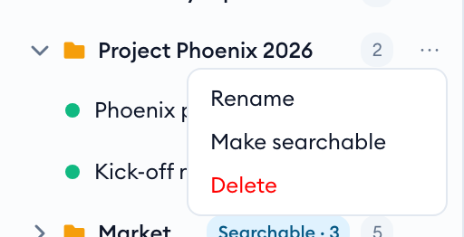

### Indexing and the searchable menu

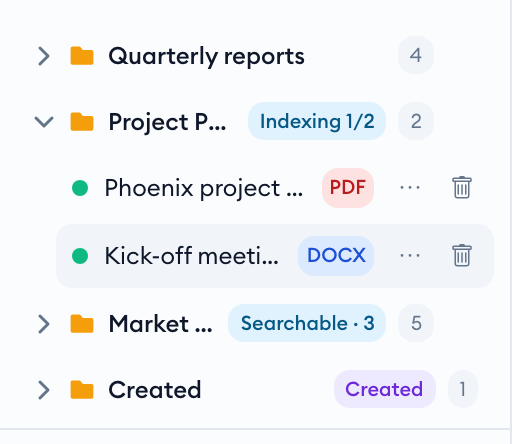
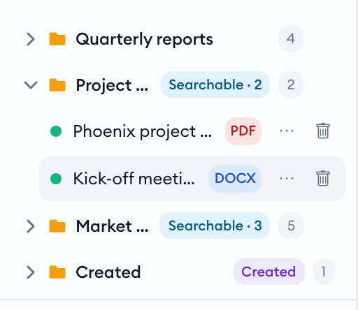

A searchable folder's menu has three more options: **Add to a skill…**, **Who can search…** and **Stop searching**.

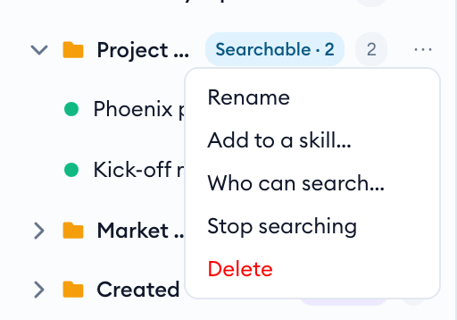

## Let a skill search the folder

Connect the folder to a skill so the assistant can search it when you chat with that skill. Some skills already search your own folders, so check [which folders a skill searches](#which-folders-a-skill-searches) first.

1. Click **⋯** on a searchable folder, then **Add to a skill…**
2. Pick a skill. The skill you're chatting with is listed first and marked *(this chat)*, followed by skills you own.
3. The panel checks straight away who would be able to search your documents through that skill.
4. If that's fine, click **Add to …**
5. Start a new chat with the skill to use the folder.

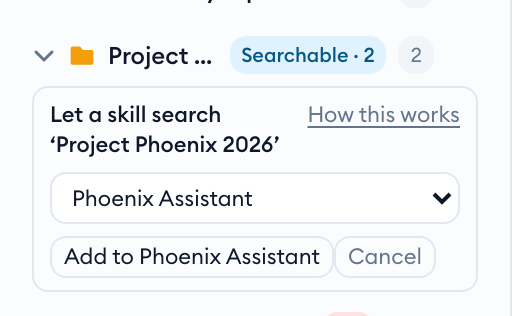
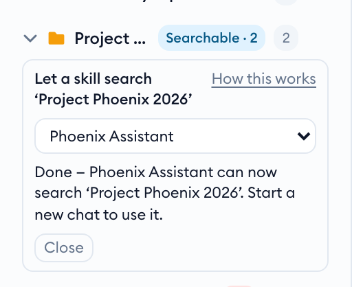

### When the skill reaches more people than the folder

A skill shared with your whole organisation can't search a folder that only you can see without exposing those documents. The panel shows who uses the skill and who can search the folder.

If you choose to go ahead, one button shares the folder with exactly the skill's audience and adds it. Nothing is widened unless you click it.

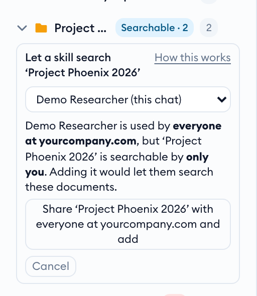

### When the skill isn't yours to change

Most skills you use were shared with you by someone else, or are built into the platform. You can't change those. The panel tells you before you click anything and offers one button instead:

1. Click **Make my copy and add ‘…’**.
2. You get your own copy of the skill: same instructions and tools, private to you, and able to search your folder.
3. Click **Chat with … (Fork)** to start using it.

You only need one copy. Add more folders to it the same way, since it's now a skill you own.

> [!WARNING]
> **Your copy is a snapshot.** It won't pick up later improvements to the original. If the whole team should search a folder, ask the skill's owner to add it instead.

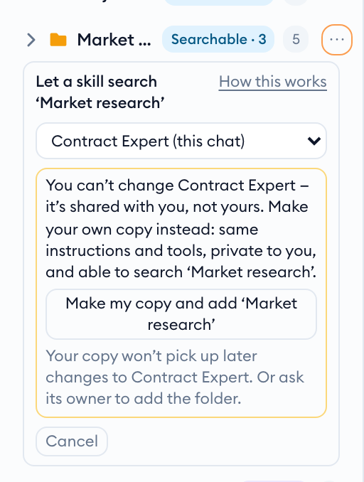
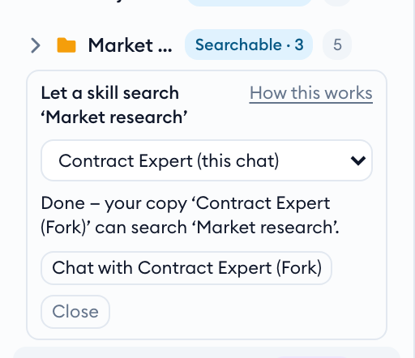

### Skills that already search your own folders

Some skills are set up to search *each user's own* searchable folders, either themselves or through a specialist they hand questions to. With these there's nothing to add: make a folder searchable and just ask. If you open **Add to a skill…** anyway, the panel tells you so.

This is safe on a skill the whole team uses. Everyone reaches only the folders they made searchable themselves, never anyone else's.

**Skill owners:** in Skill Studio, tick **Search knowledge bases**, then **Each user's own searchable folders**. You can also pick specific shared folders from the same list.

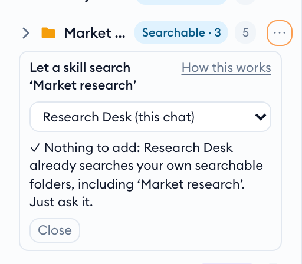
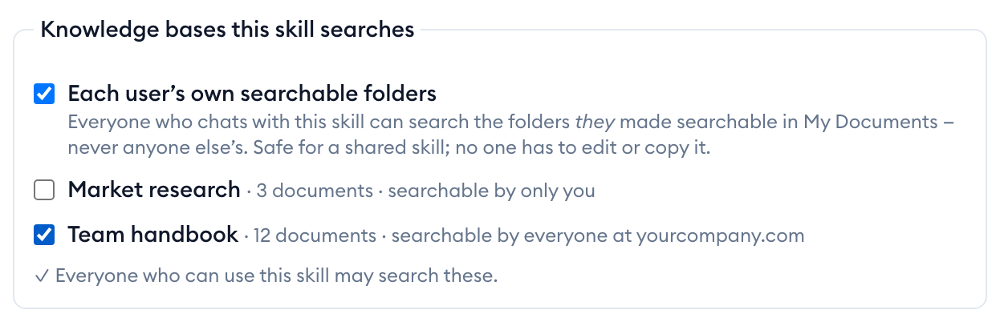

## Which folders a skill searches

"Your own folders" means folders *you* own and made searchable. A folder someone else shares with you doesn't count, even if you can see it.

| The folder | In a skill that searches your own folders | What to do |
|---|---|---|
| Yours, made searchable | Searched automatically | Nothing. Just ask. |
| Shared with you by a colleague | Not searched | It has to be added to a skill. If the whole team needs it, ask the skill's owner or an admin to add it. If only you do, use **Add to a skill…** on a skill you own, or make your own copy. |
| Yours, shared with your team | Searched for you only | Your colleagues reach it only through a skill it's added to. [Who can search](#choose-who-can-search) controls who that skill may show it to. |

## Choose who can search

Change who can search the folder through skills, without opening each skill.

1. Click **⋯** on the folder, then **Who can search…**
2. Choose *Private* (only you), a group, everyone at your domain, or specific people.
3. Click **Save**.

Skills can only reach the people this setting allows. If you narrow it, the change applies immediately, including to skills already using the folder.

The folder doesn't appear in anyone else's My Documents. But search results quote passages from your documents, so anyone you allow here can read those passages through a skill.

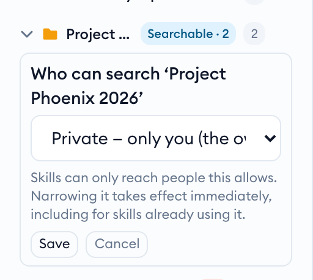

## Stop searching a folder

Turn search off when a folder shouldn't be used by skills any more.

1. Click **⋯** on the folder, then **Stop searching**.
2. Confirm with **Stop searching**.

The folder's search index is deleted, and any skill that used it loses access. *Your documents stay* in the folder, and you can make it searchable again at any time.

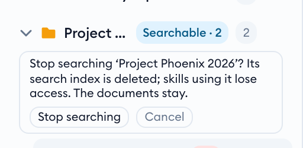

## Upload a folder from the command line

For large folders or scripted uploads, the `aiplatform` CLI does the same thing as the button, including skipping unchanged files.

```bash
# upload a folder, keeping its subfolders
aiplatform docs upload -r "Quarterly reports"

# put everything under a name prefix, 6 uploads at once
aiplatform docs upload -r ./exports --folder "Archive" --jobs 6

# single files into a folder by name (created if you don't have one yet)
aiplatform docs upload terms.pdf --folder "Contracts"

# send every file again, even unchanged ones
aiplatform docs upload -r "Quarterly reports" --reupload
```

| Option | What it does |
|---|---|
| `-r`, `--recursive` | Upload directories and keep their subfolders. Hidden files and `node_modules` are skipped. |
| `--folder NAME` | For single files, the target folder, by name (not case-sensitive) or by folder id. If you have no folder with that name, it is created first and the command prints `Created folder 'NAME'.` If two of your folders share the name, the command stops and lists them; pass the id of the one you mean. For a directory, a name prefix for the folders it creates. |
| `--jobs N` | Uploads at once, 1–8 (default 3). |
| `--reupload` | Don't skip files that are already in the library unchanged. |

The command ends with a summary and exits with an error code if any file failed.
