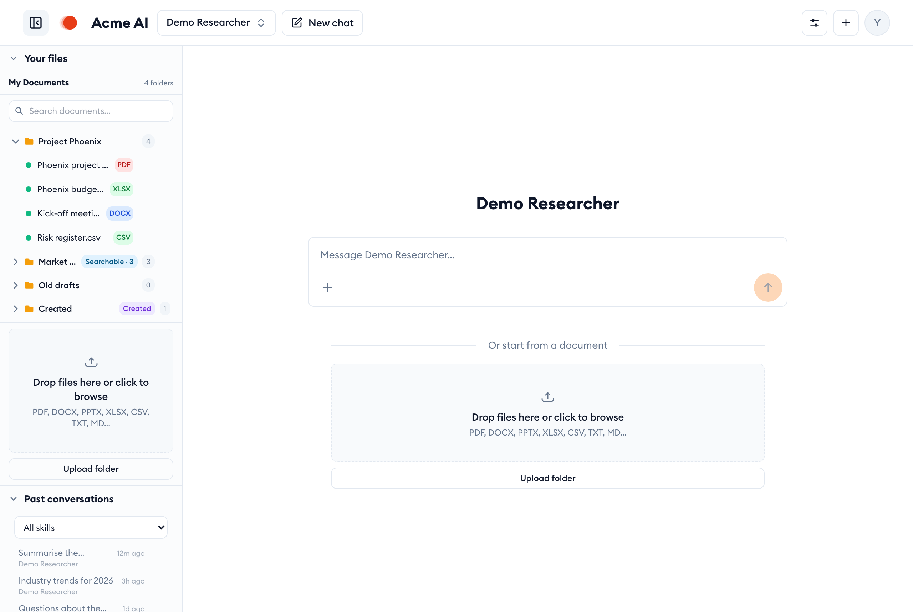
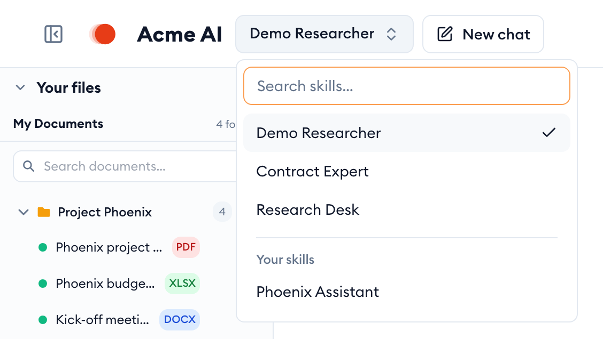
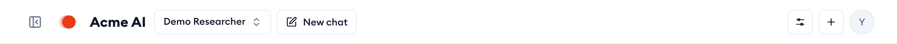
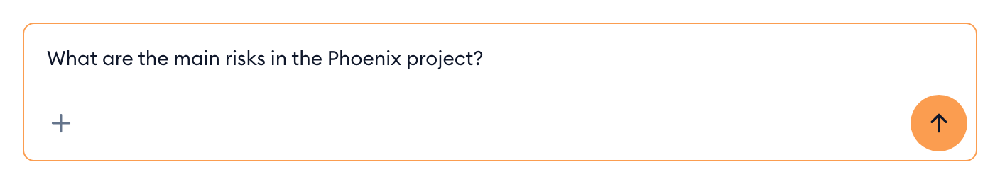
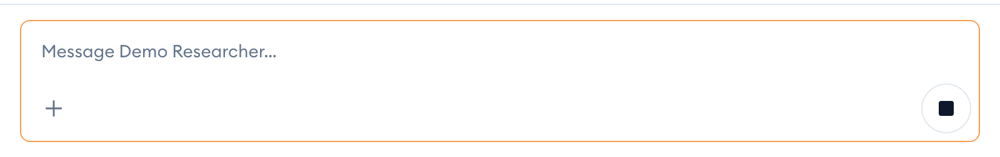
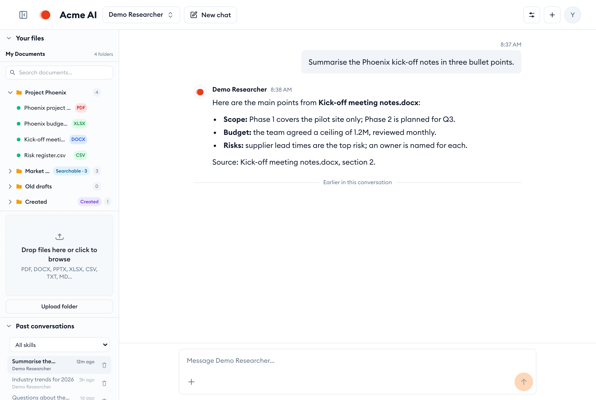
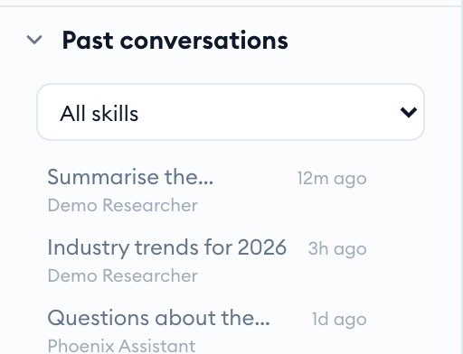
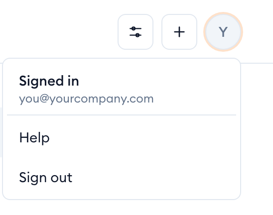
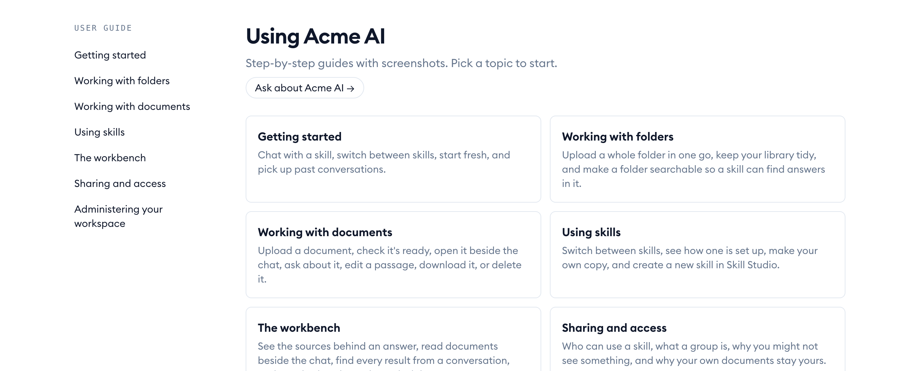
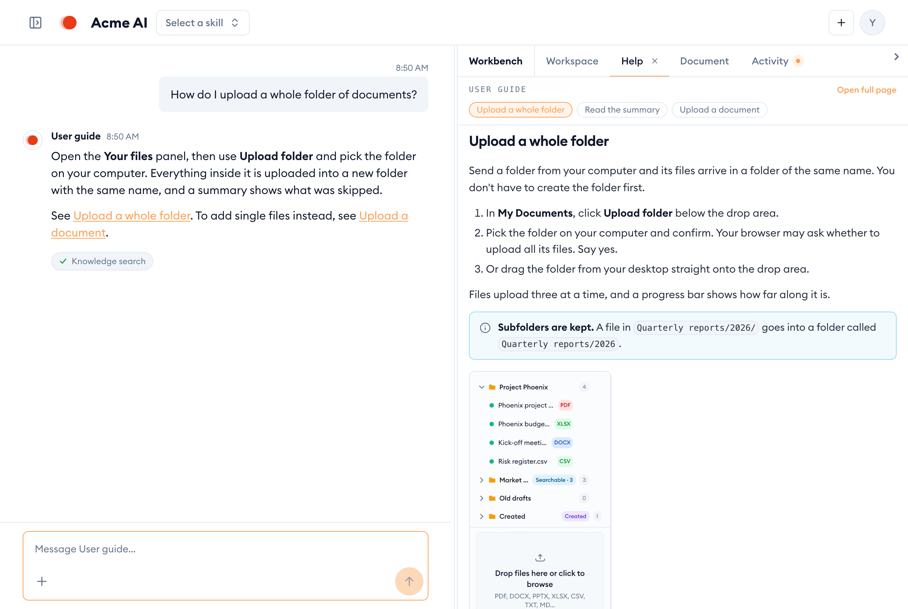

In {{appName}} you chat with **skills**: assistants that are each set up for one kind of work, such as research, reviewing contracts or answering questions about a project. The page has three parts: the header with the skill you're talking to, the sidebar with your files and past conversations, and the conversation itself.

## Pick a skill

The skill you're talking to is named at the top left of the header.

1. Click the skill's name to open the list of skills you can use.
2. Type in **Search skills…** to find one by name, or scroll the list.
3. Click a skill to switch to it. A tick marks the one you're using now.

Skills shared with you or built in come first. Skills you made yourself are listed under **Your skills**.

> [!NOTE]
> Switching skill starts a new conversation with that skill. Your earlier conversation stays in **Past conversations**.

## Start a new chat

Click **New chat** in the header to clear the conversation and start again with the same skill. Use it when you change topic: a fresh chat keeps answers focused on what you're asking now.

## Send a message

1. Type in the message box at the bottom: it reads *Message* followed by the skill's name.
2. Press `Enter` to send, or click the round arrow button. Press `Shift`+`Enter` for a new line without sending.
3. While the answer is being written, the arrow becomes a square stop button. Click it, or press `Esc`, to stop the reply.

To include a document, click **+** (**Attach a document**) at the bottom left of the box and pick a file. You can also start a chat from a document: drop it onto the area below the message box on an empty chat.

> [!TIP]
> Ask the way you would ask a colleague: say what you need and what it's for. "Summarise the kick-off notes in three bullet points for the steering group" gets a better answer than "kick-off notes".

## Read the answer

The answer appears under your message, with the skill's name and the time. When a skill used documents or searched for the answer, it says where the information came from, so you can check it. Some skills also open results in the workspace next to the chat.

Treat an answer like a colleague's first draft: check the sources for anything you're going to rely on.

## Find a past conversation

Every conversation is kept. Open the sidebar with the panel button at the top left and look under **Past conversations**:

1. Each row shows the conversation's first question, which skill it was with, and how long ago.
2. Click a row to reopen it and carry on where you left off.
3. To see only one skill's conversations, pick it in the list that starts with **All skills**.

Conversations other people share with you are listed separately, under **Shared with me**.

## Get help

Open the account menu (your initial at the top right of the header) and choose **Help** to come back to this guide.

On the guide's first page, **Ask about …** opens a chat with a skill that answers questions about using {{appName}}, using this guide, and links you to the right section.

### Ask how to do something

Ask the user guide skill a question in your own words. Its answer links to the guide sections it used, and the workbench shows the guide page itself on a **Help** tab, opened at the right section, screenshots included.

- When more than one section matched, pick between them at the top of the **Help** tab.
- Click a link in the answer to open that section on the **Help** tab.
- **Open full page** opens the page in a new browser tab.

