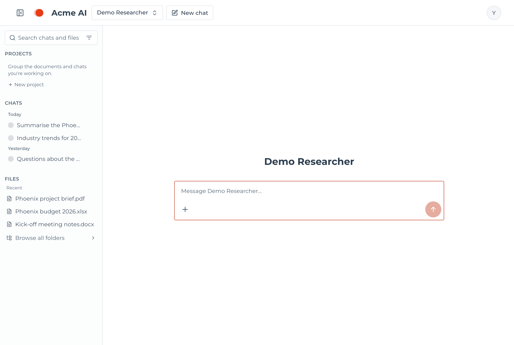
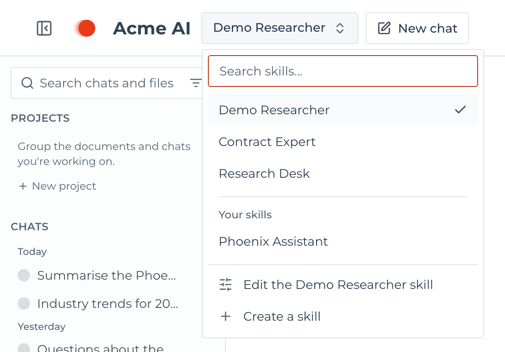
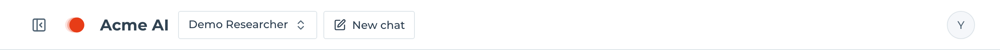
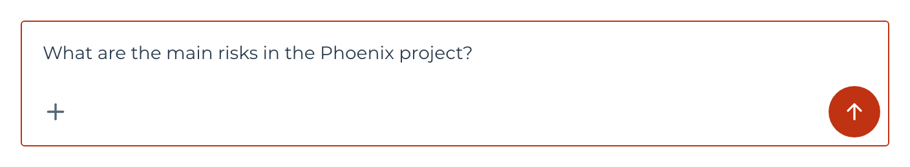
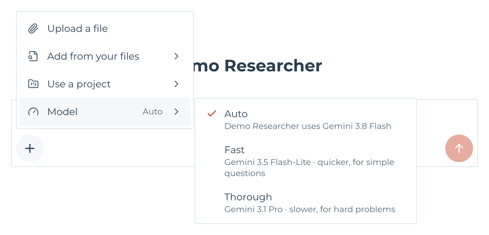
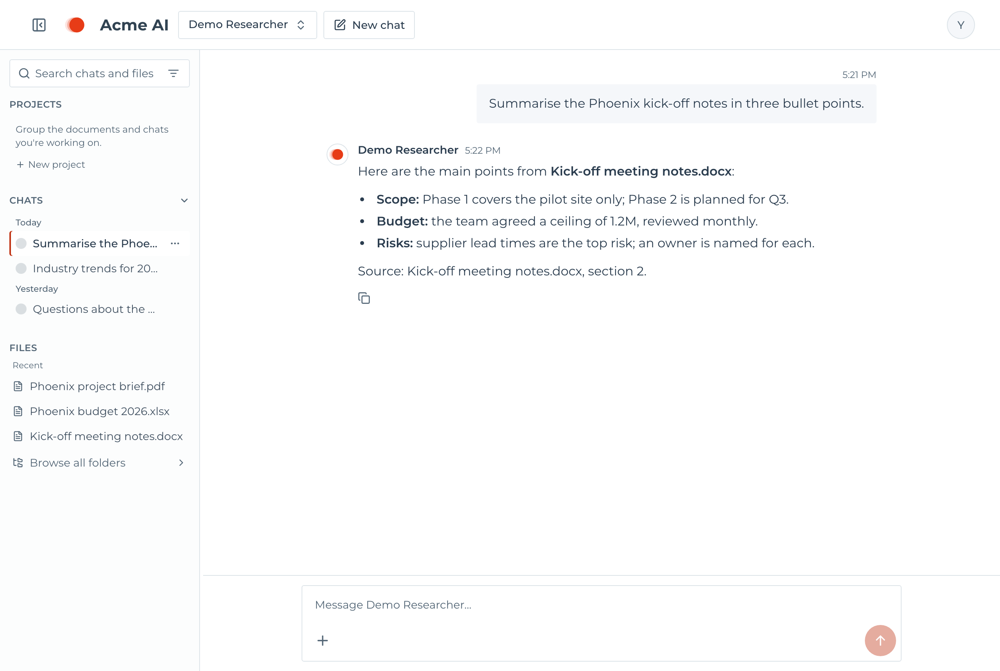
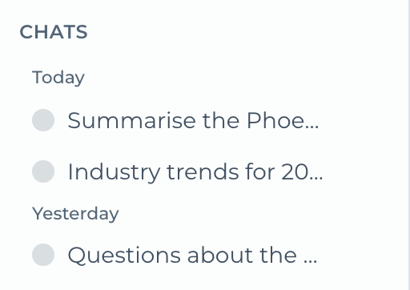
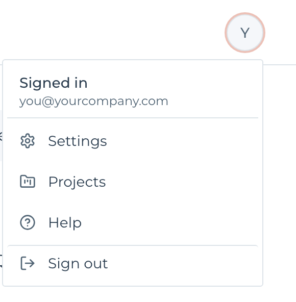
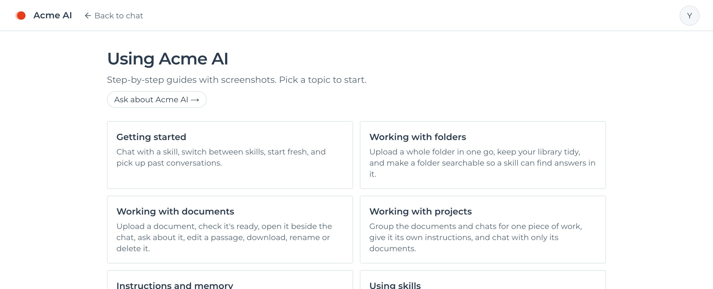
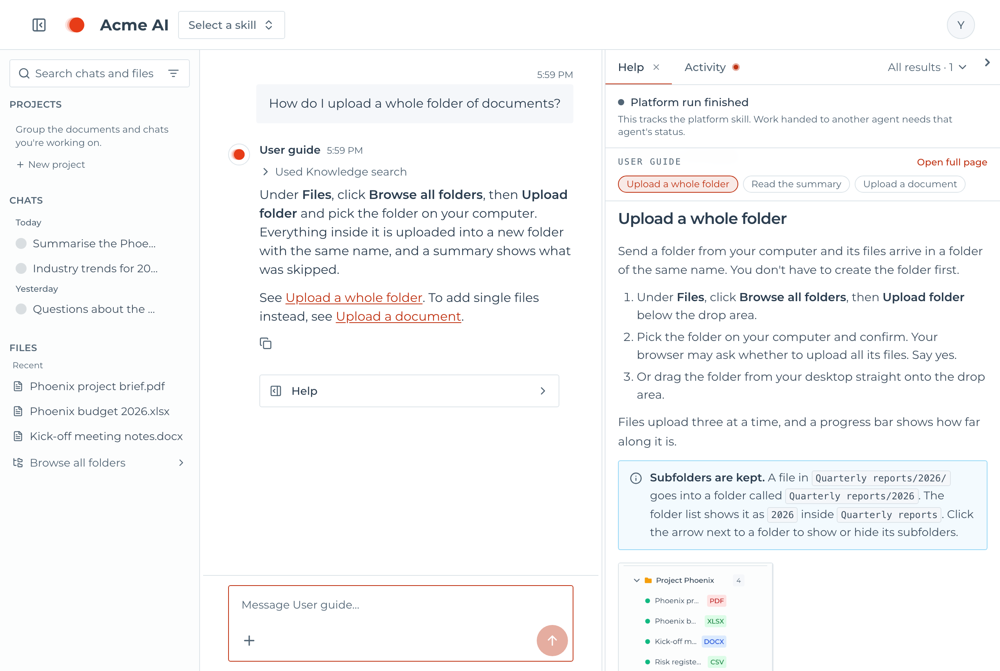

In {{appName}} you chat with **skills**: assistants that are each set up for one kind of work, such as research, reviewing contracts or answering questions about a project. The page has three parts: the header with the skill you're talking to, the sidebar with your projects, past conversations and files, and the conversation itself.

## Pick a skill

The skill you're talking to is named at the top left of the header.

1. Click the skill's name to open the list of skills you can use.
2. Type in **Search skills…** to find one by name, or scroll the list.
3. Click a skill to switch to it. A tick marks the one you're using now.

Skills shared with you or built in come first. Skills you made yourself are listed under **Your skills**.

> [!NOTE]
> Switching skill starts a new conversation with that skill. Your earlier conversation stays under **Chats** in the sidebar.

## Start a new chat

Click **New chat** in the header to start a fresh conversation. Use it when you change topic: a fresh chat keeps answers focused on what you're asking now.

- If your workspace has a starting skill, **New chat** opens a fresh chat with it. Otherwise it stays with the skill you were using.
- In a [project](projects.md#chat-in-a-project), the new chat stays in the project.

Your earlier conversation is kept under **Chats** in the sidebar.

## Send a message

1. Type in the message box at the bottom: it reads *Message* followed by the skill's name (in a project, *Ask about* followed by the project's name).
2. Press `Enter` to send, or click the round arrow button. Press `Shift`+`Enter` for a new line without sending.
3. While the answer is being written, the arrow becomes a square stop button. Click it, or press `Esc`, to stop the reply.

To include a document, click **+** at the bottom left of the box: **Upload a file** for a new one, or **Add from your files** for one you uploaded before. On a computer you can also drop a file anywhere on the chat.

> [!TIP]
> Ask the way you would ask a colleague: say what you need and what it's for. "Summarise the kick-off notes in three bullet points for the steering group" gets a better answer than "kick-off notes".

### Choose a faster or more thorough model

Each skill picks its own AI model, and that's right for most questions. To change it for one chat, click **+**, then **Model**:

- **Auto** (the default): the skill's own model.
- **Fast**: quicker replies, for simple questions.
- **Thorough**: slower, for hard problems.

Each choice shows the name of the model it uses. While a chat isn't on Auto, its choice appears next to the **+**; click its **×** to go back to Auto. The choice stays with that chat, and a new chat starts on Auto.

To choose a particular model by name, turn on **Choose a specific model** under **Settings** → **Models**. The **Model** menu then also lists every model your workspace allows.

> [!NOTE]
> Some skills always use their own model, for example one named after its model. Their **Model** menu says so instead of offering choices. Where a choice would make no difference for the skill you're using, it isn't shown.

## Read the answer

The answer appears under your message, with the skill's name and the time. When a skill used documents or searched for the answer, it says where the information came from, so you can check it. Some skills also open results in the workspace next to the chat.

Treat an answer like a colleague's first draft: check the sources for anything you're going to rely on.

Answers can include tables, code and mathematical formulas; formulas are shown typeset, the way they'd appear in a paper.

### When an answer stops with an error

If something goes wrong, a message appears where the answer would be. It says what happened and offers a way on:

- **The answer was cut off:** the AI model hit a temporary error partway through, so the reply on screen is incomplete. Click **Retry answer** for the full answer.
- **Try again** sends your question again after other temporary errors, such as the service being busy.
- **Reload conversation** appears when the connection dropped, for example because you left the app on your phone. The reply may still have arrived, so reload to check before asking again.
- **Dismiss** closes the message.

## Find a past conversation

Every conversation is kept, in the sidebar. Open it with the button at the top left (**Show conversations and files**) and look under **Chats**:

1. Conversations are grouped by when you last used them: **Today**, **Yesterday**, **Previous 7 days** and so on. Each row shows the conversation's title, with the icon of the skill it was with. Hover over a row to see the skill's name.
2. Click a row to reopen it and carry on where you left off.
3. Type in **Search chats and files** at the top of the sidebar to find one by its title.
4. To see only one skill's conversations, click the filter icon in the search box and pick the skill.
5. **Show more** under the list shows the rest.

On a wide screen the sidebar starts open. After that it stays open or closed the way you left it.

To rename or delete a conversation, hover over it, click its **⋯**, then **Rename** or **Delete…**. Deleting a conversation doesn't delete what the assistant [remembered](memory.md#what-the-assistant-remembers) from it. The same menu moves a conversation into a [project](projects.md#move-a-chat-into-or-out-of-a-project).

A row marked **Messages unavailable** is a conversation whose messages can no longer be recovered.

Conversations other people share with you are listed separately, under **Shared with me**.

## Get help

Open the account menu (your initial at the top right of the header) and choose **Help** to come back to this guide.

On the guide's first page, **Ask about …** opens a chat with a skill that answers questions about using {{appName}}, using this guide, and links you to the right section.

### Ask how to do something

Ask the user guide skill a question in your own words. Its answer links to the guide sections it used, and the workbench shows the guide page itself on a **Help** tab, opened at the right section, screenshots included.

- When more than one section matched, pick between them at the top of the **Help** tab.
- Click a link in the answer to open that section on the **Help** tab.
- **Open full page** opens the page in a new browser tab.

