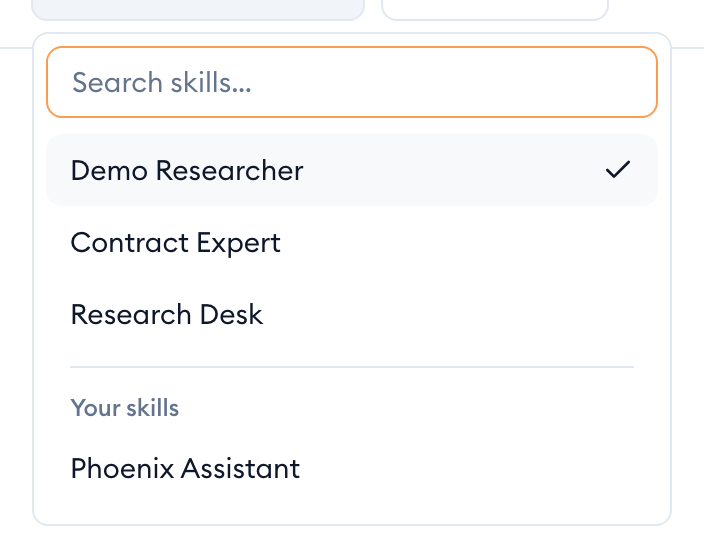
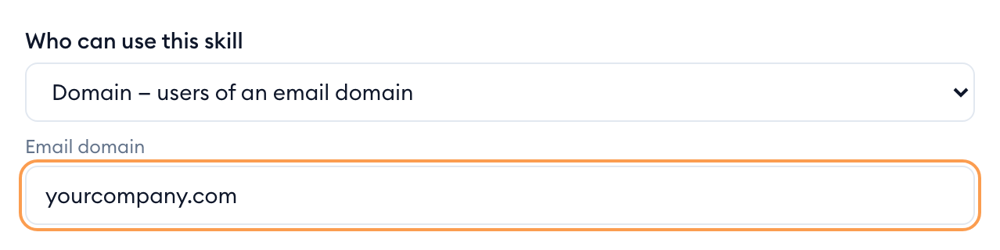
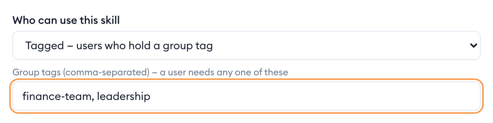
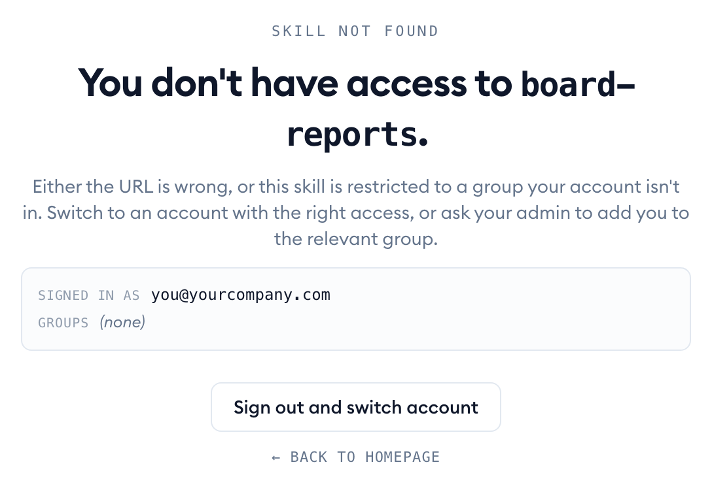
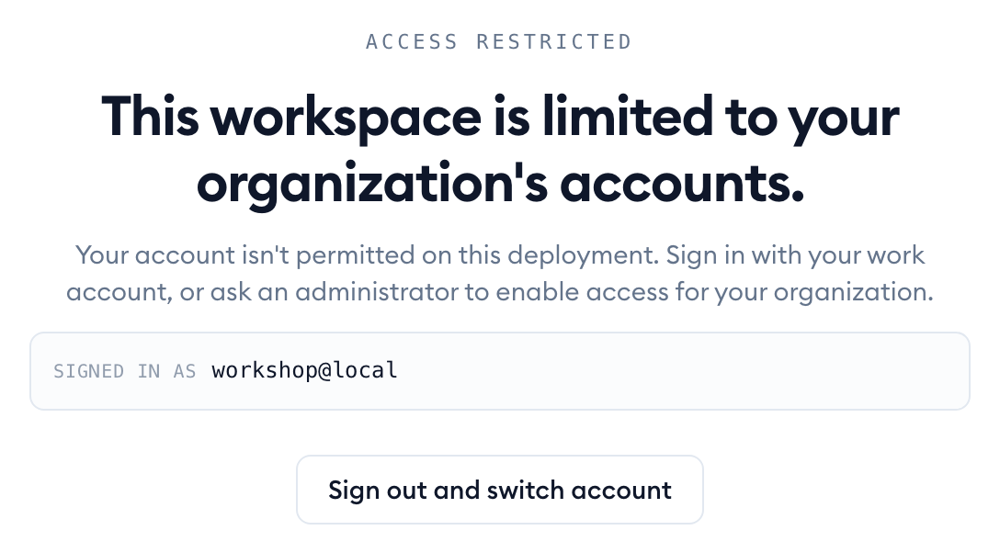

Everything in {{appName}} has an owner and a setting for who else may use it. This page explains those settings for skills, what a group is, and what you see when something isn't open to you.

## Find the skills you can use

The skill picker at the top of the chat lists every skill you're allowed to use, and only those. Type in **Search skills…** to narrow the list. Skills you made yourself are grouped under **Your skills**.

If a colleague mentions a skill that isn't in your list, it hasn't been shared with you. See [When you can't open a skill](#when-you-cant-open-a-skill).

> [!NOTE]
> Your organisation's administrator can also choose which skills appear for your workspace. A skill can be shared with you and still be hidden there.

## Who can use a skill

Every skill has one of five settings. Whatever the setting, the skill's owner can always use it.

| Setting | Who can use the skill |
|---|---|
| **Private — only you (the owner)** | Only the person who made it. New skills start here. |
| **Tagged — users who hold a group tag** | Anyone in at least one of the listed [groups](#what-a-group-is). |
| **Domain — users of an email domain** | Everyone who signs in with an email address at that domain, for example everyone at `yourcompany.com`. |
| **Specific — a list of emails** | Only the people whose email addresses are listed. |
| **Public — anyone (listed in the marketplace)** | Anyone at all, including people who aren't signed in. |

Built-in skills come with {{appName}} and are set up by its administrators, usually for a group or your whole organisation. You can use them, but you can't change them. To adapt one, make your own copy: see [When the skill isn't yours to change](folders.md#when-the-skill-isnt-yours-to-change).

## Choose who can use your skill

You can change the setting on any skill you own.

1. Open the skill in Skill Studio.
2. Find **Who can use this skill** and pick a setting.
3. Fill in the box that appears: the **Email domain**, the group tags, or the email addresses.
4. Click **Save**.

The change applies straight away. Narrowing a skill removes it from the picker of anyone who no longer qualifies.

> [!WARNING]
> **Public means anyone.** A public skill is listed for everyone, including people who aren't signed in, so you're asked to confirm first. Never make a skill public if it can reach confidential documents.

## What a group is

A group is a label an administrator gives to accounts, such as `finance-team`. A skill shared with a group can be used by everyone who holds that label. If a skill lists several groups, you need just one of them.

You can't join a group yourself. Ask your administrator. To see which groups you're in, open a skill you don't have access to: the panel lists your **Groups**.

## When you can't open a skill

If you follow a link to a skill you can't use, you see **Skill not found** instead of the chat. It looks the same whether the skill doesn't exist or exists but isn't shared with you, so a link can't reveal private skills.

The panel shows which account you're **Signed in as** and its **Groups**. That's usually enough to spot the problem:

- **Wrong account?** Click **Sign out and switch account** and sign in with the right one.
- **Right account, missing group?** Ask your administrator to add you to the group the skill is shared with, or ask the skill's owner to share it with you.

## When your account isn't let in

{{appName}} is set up for particular organisations. If you sign in with an account from an organisation that hasn't been set up, every page shows **Access restricted** instead. Sign in with your work account, or ask an administrator to enable access for your organisation.

## Who can search your folders

Folders you make searchable have their own setting, chosen from the folder's **Who can search…** menu item. It decides who can search the folder through skills. See [Choose who can search](folders.md#choose-who-can-search).

## Your documents stay yours

- **My Documents is private.** Nobody else sees your folders or documents in their sidebar, whatever you share.
- **Skills only read your documents for you.** When you ask a skill about your documents, it can only reach your own. When a colleague uses the same skill, it can only reach theirs.
- **Searching follows the folder's setting.** A skill shared with others reaches your documents only through folders you made searchable *and* shared with those people. You're asked before a folder is shared more widely.
