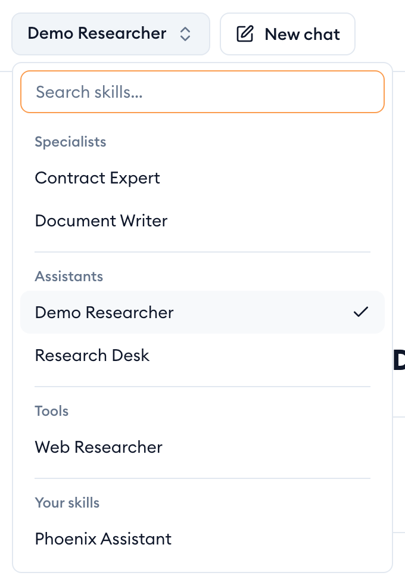
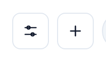
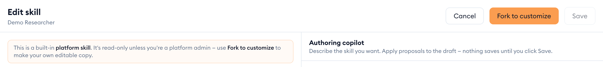
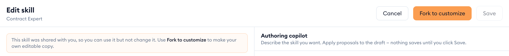
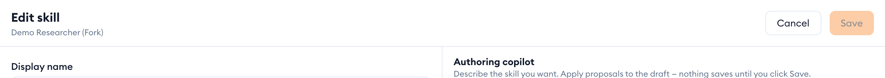
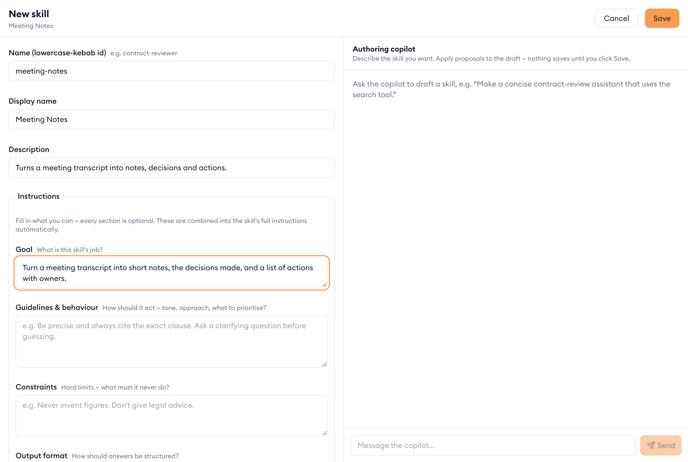
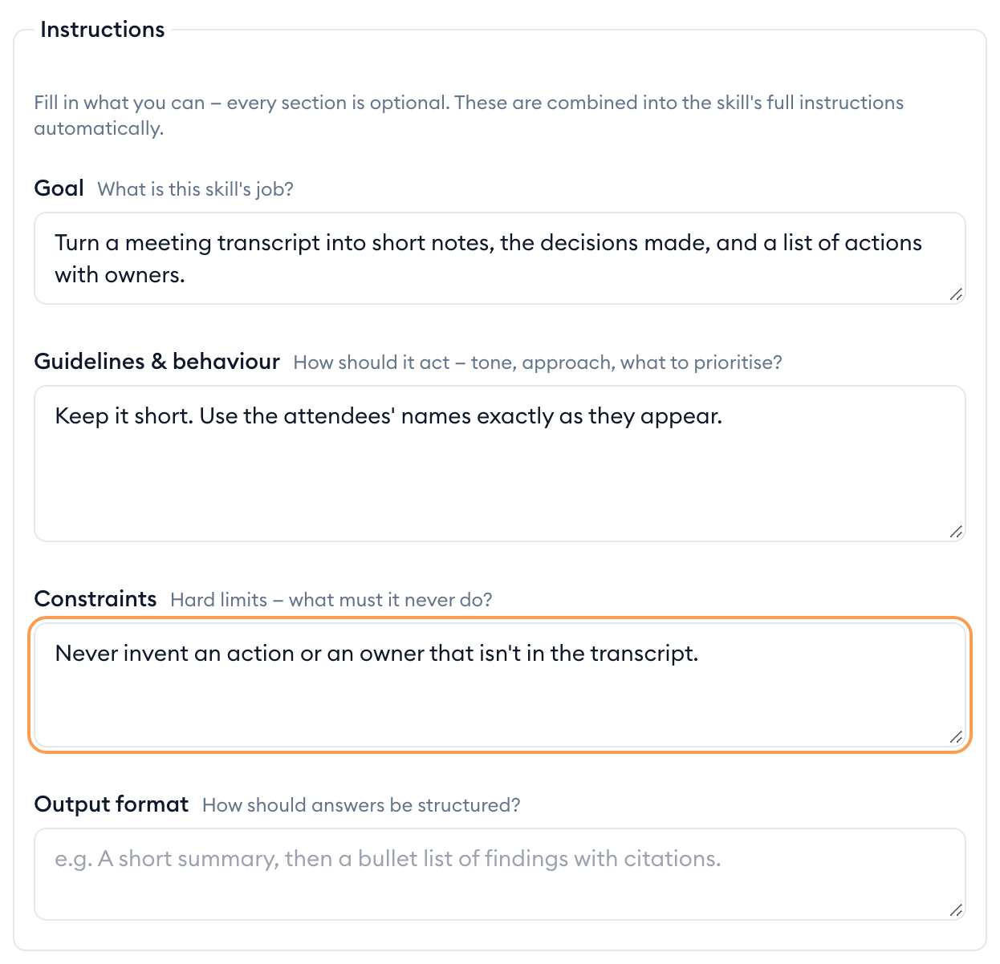
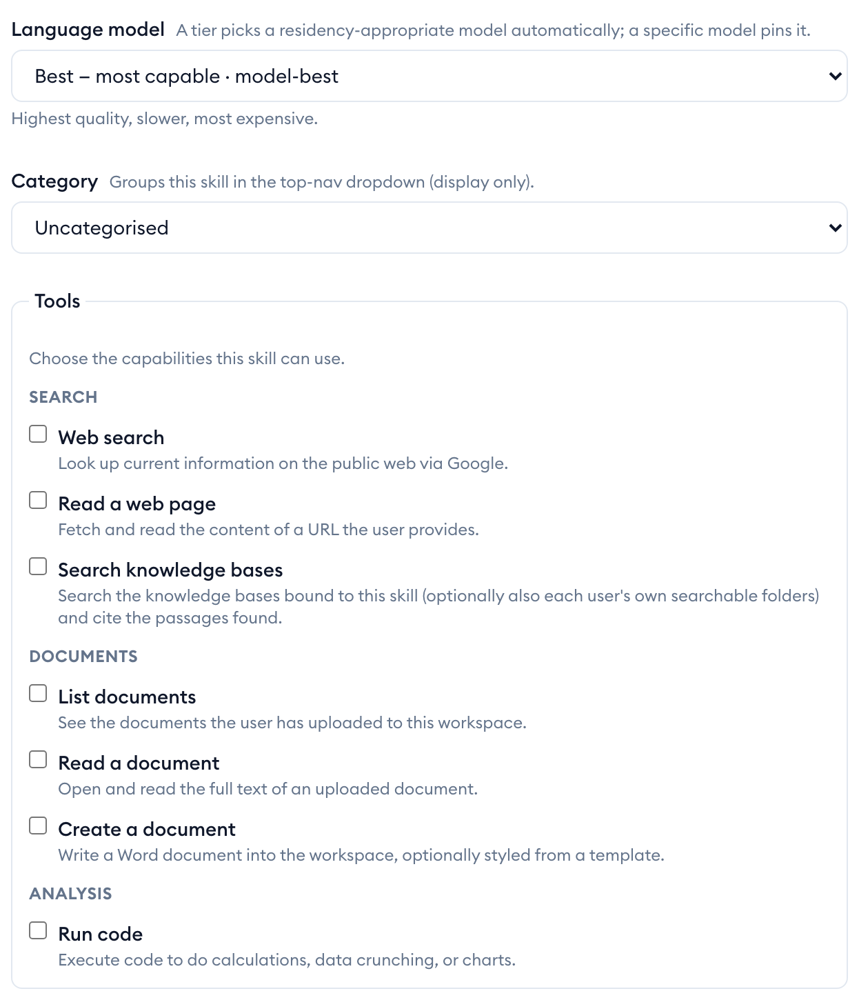

A skill is an assistant set up for one kind of job: its instructions, the language model it uses, the tools it may call (web search, your documents, knowledge bases…) and who may use it. The skill you're chatting with is named at the top of the page.

## Switch to another skill

1. Click the skill's name at the top of the page, next to **New chat**.
2. Type in **Search skills…** to narrow the list, or scroll it.
3. Click a skill to chat with it.

Skills are grouped: **Your skills** are the ones you made or copied; the rest are grouped as **Specialists**, **Assistants** and **Tools**, with anything uncategorised under **Other skills**. The list only shows skills you're allowed to use.

## See how a skill is set up

1. Click **Configure this skill**: the sliders button at the top right. On a phone it's in the menu.
2. Skill Studio opens with the skill's instructions, model, tools and who can use it.

The **Create a new skill** button next to it starts an empty skill instead.

## Built-in skills

Some skills come with {{appName}} — they're kept up to date for everyone and marked as a **platform skill** in Skill Studio. You can open one to see how it's set up, but you can't change it (only a platform admin can). To adapt one, make your own copy.

## Make your own copy of a skill

1. Open the skill with **Configure this skill**.
2. Click **Fork to customize**.
3. Your copy opens in Skill Studio, named "… (Fork)": same instructions and tools, private to you. Change what you like and click **Save**.

The button is there straight away for any skill you can't change: a built-in skill, or one a colleague shared with you. For a shared skill, Skill Studio also says so at the top and **Save** stays off.

> [!WARNING]
> **Your copy is a snapshot.** It won't pick up later improvements to the original. If something should change for everyone, ask the skill's owner.

Adding one of your folders to a skill you can't change makes the copy for you in one step — see [When the skill isn't yours to change](folders.md#when-the-skill-isnt-yours-to-change).

## Create a new skill

1. Click **Create a new skill** (the plus button at the top right).
2. Give it a **Name (lowercase-kebab id)**, for example `meeting-notes`, a **Display name** people will see, and a one-line **Description**.
3. Fill in its instructions, model and tools (below), then click **Save**.

The **Authoring copilot** on the right can draft a skill for you: describe what you want and click **Apply** on its proposal. Nothing is saved until you click **Save**, and **Cancel** leaves without saving.

### Write the instructions

The **Instructions** are what the skill is told before every chat. Every part is optional and they're combined for you:

- **Goal**: the skill's job, in a sentence.
- **Guidelines & behaviour**: tone, approach, what to prioritise.
- **Constraints**: what it must never do.
- **Output format**: how answers should be laid out.
- **Additional instructions**: anything else.

### Choose the model and tools

- **Language model**: pick a tier — best, pro or lite. Faster, cheaper models suit simple skills; the most capable ones suit hard reasoning.
- **Category** decides which group the skill appears under in the switcher.
- **Tools** are what the skill can do beyond chatting: search the web, read a web page, read your documents, create a Word document, run code, search knowledge bases. Tick only what it needs.

### Let it search knowledge bases

1. In **Tools**, tick **Search knowledge bases**.
2. A **Knowledge bases this skill searches** box appears. Tick the shared knowledge bases it should search.
3. Tick **Each user's own searchable folders** to let everyone who chats with the skill search the folders *they* made searchable — never anyone else's.

The box checks straight away that everyone who can use the skill may search what you picked. To make one of your folders searchable first, see [Make a folder searchable](folders.md#make-a-folder-searchable).

## Share your skill

New skills are private to you. To let others use one, change **Who can use this skill** in Skill Studio and click **Save**: you can share it with a group, everyone at your email domain, or named people. The options, and what each one means, are in [Sharing and access](sharing-and-access.md#choose-who-can-use-your-skill).

A skill can only search knowledge bases that reach at least the same people. If one doesn't, saving tells you which.
