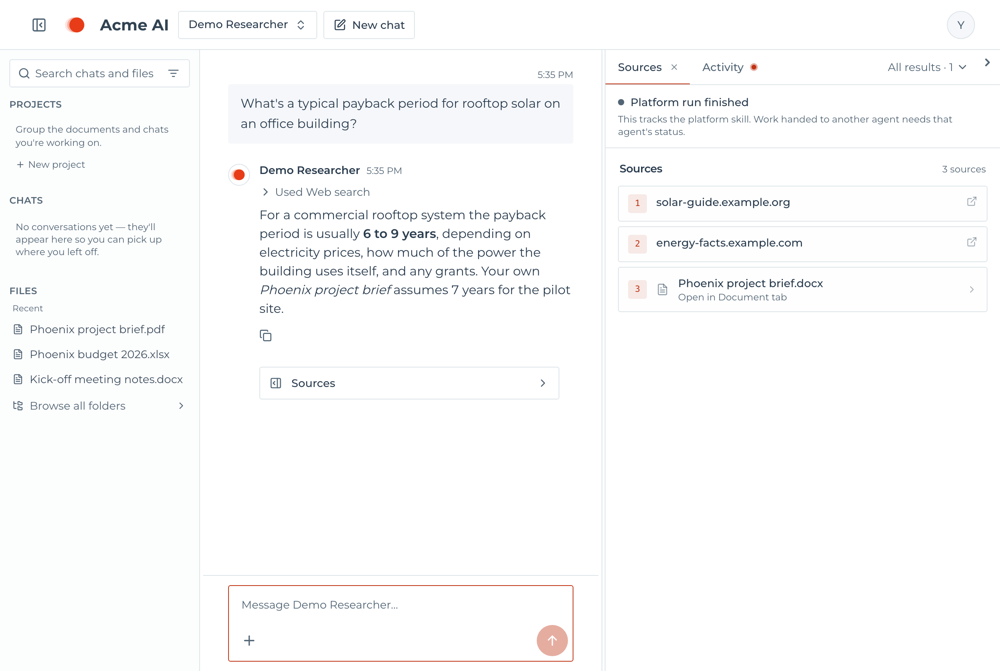
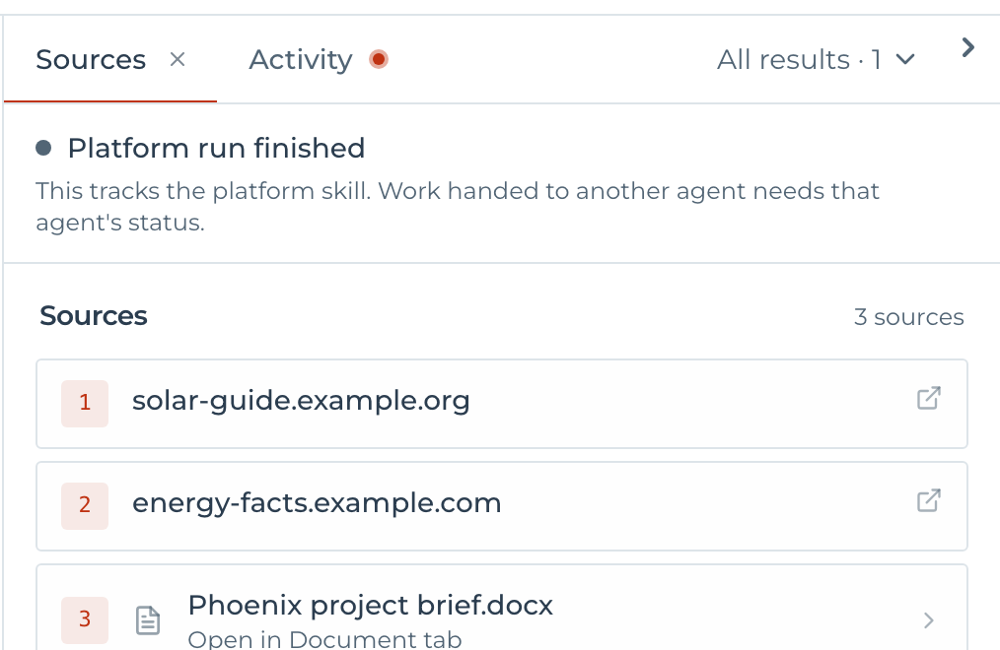
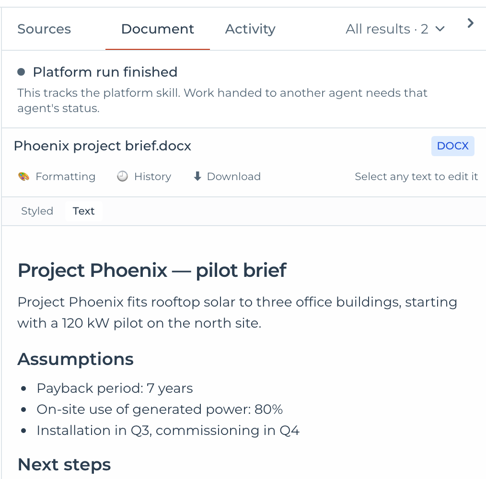
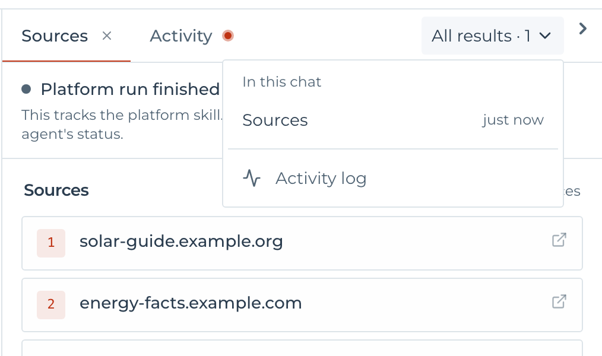
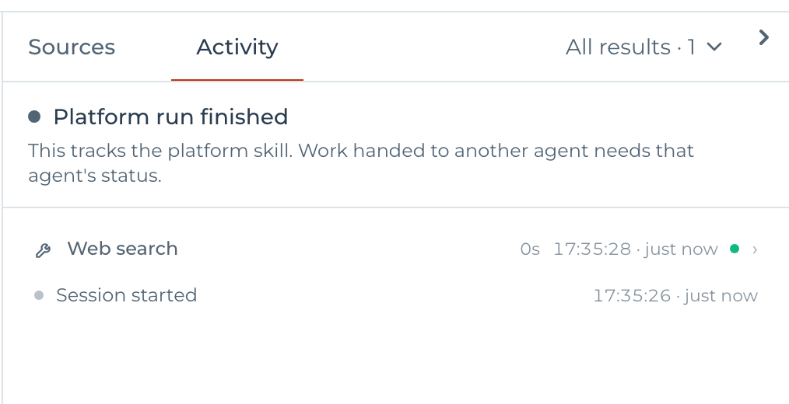
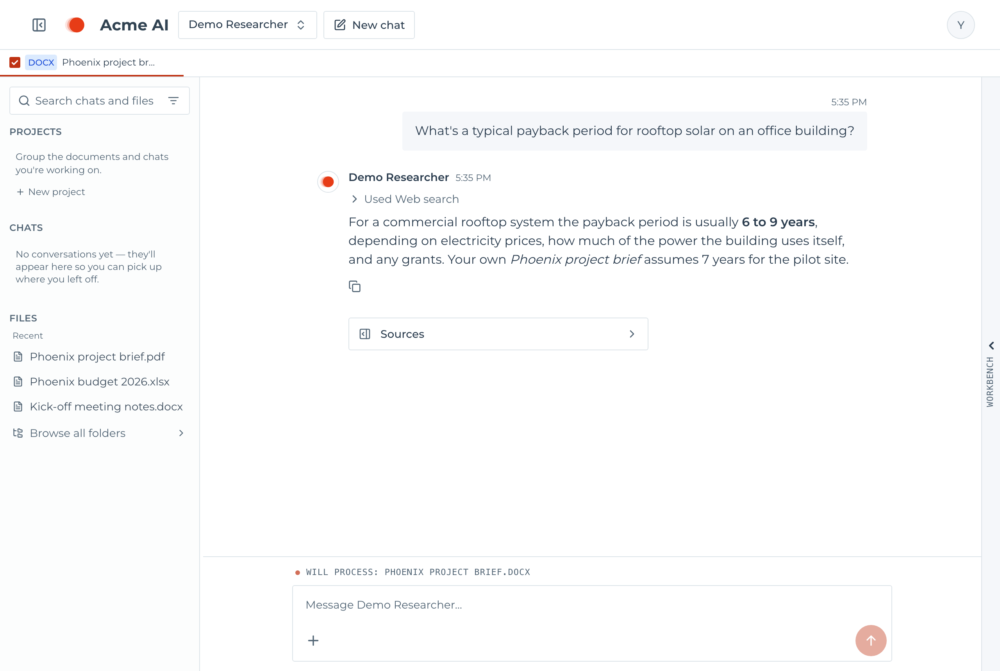

The **Workbench** is the panel that opens beside the chat as soon as there's something to show: the sources an answer used, a document you're reading, or a result the assistant produced. Its tabs are what's open: one tab per result (such as **Sources**), the **Document** you're reading, and **Activity**. Skills that come with examples or tools also have a **Start** tab.

## See where an answer came from

When the assistant searches the web or your documents, the pages and files it used appear in a **Sources** tab. On a computer the Workbench switches to it on its own, so you can check the answer straight away. On a phone, tap the **Sources** card under the reply.

1. Look at the numbered list in **Sources**. Each row is one source the answer drew on.
2. Click a web page to open it in a new browser tab.
3. Click a document marked **Open in Document tab** to read it beside the chat.

Sources only lists what the search returned. If a statement in the answer isn't backed by anything here, treat it with care and ask the assistant where it came from.

## Read a document beside the chat

The **Document** tab shows one document next to the conversation, so you can read it while you ask about it.

1. Open a document from **Sources**, or click a document in the sidebar under **Files**.
2. Switch between **Styled**, which looks like the original file, and **Text**, the plain text the assistant reads.
3. Use **Formatting**, **History** and **Download** along the top to restyle it, see earlier versions, or save a copy.
4. **Conversations** at the bottom lists your other chats about this document.

> [!NOTE]
> Opening a document also adds it to your next message. A chip with its name appears above the chat, and the message box says **Will process:** with the file name, so you can ask about it directly.

## Find every result from this chat

Each result also has a card in the conversation, under the reply that produced it: click the card to bring the result to the front.

**All results**, at the right of the Workbench's tabs, lists every result from this conversation, including ones whose tab you closed, so nothing gets lost when the assistant produces several.

1. Click **All results**.
2. Click a result to bring its tab to the front. If you have a document open, it's listed too.
3. **Activity log** at the bottom opens the **Activity** tab.

To remove a result you no longer need, click **×** on its tab. You're asked to confirm first, because getting it back means running the question or analysis again.

## Watch what the assistant is doing

Each reply starts with a short line that sums up the steps behind it, such as "Used Web search · 4s". Click it to see each step, and **Full activity log** to open the **Activity** tab.

The **Activity** tab shows each step the assistant takes, while it works and afterwards: which tools it called, which documents it read, and when it handed a question to another skill.

1. Click **Activity** while a reply is still coming, or afterwards to see how it got there.
2. Each row is one step, newest at the top, with a green dot when it finished.
3. Click a row to see more about that step.

If a reply is slow to start, **Activity** shows which AI model it is waiting for and for how long. When a model is busy or stops responding, the assistant moves on to another one by itself, and **Activity** shows that switch, so a long wait is never a mystery.

A dot on the **Activity** tab means something new happened while you were looking at another tab.

## Make more room for the chat

- **Resize:** drag the divider between the chat and the Workbench.
- **Hide:** click the arrow at the top right of the Workbench (**Collapse workbench**). A thin strip stays on the right edge; click it (**Expand workbench**) to bring the Workbench back with everything still in it.
- **On a phone:** the chat fills the screen. Tap a result's card in the conversation to open it full screen, and **Back to chat** to return.

## Documents the assistant creates

When you ask the assistant to write something, such as a summary, a letter or a report, it saves a real Office document to the **Created** folder in your files. From there you can open it in the **Document** tab, download it, move it, or ask for changes. See [Working with folders](folders.md#delete-a-folder) for how the **Created** folder works.
