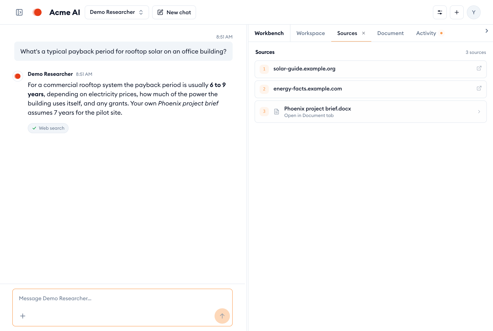
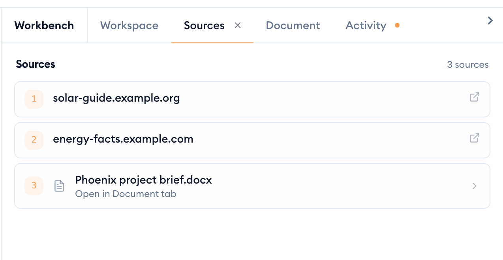
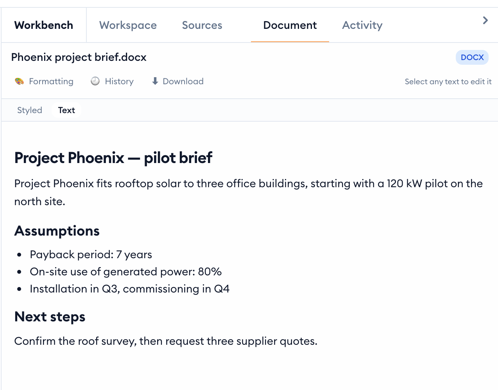
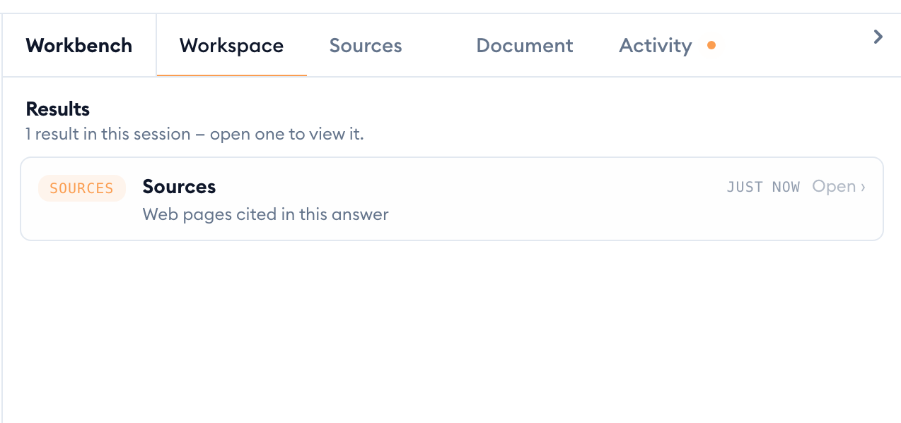
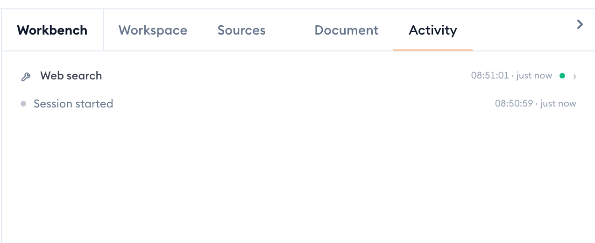
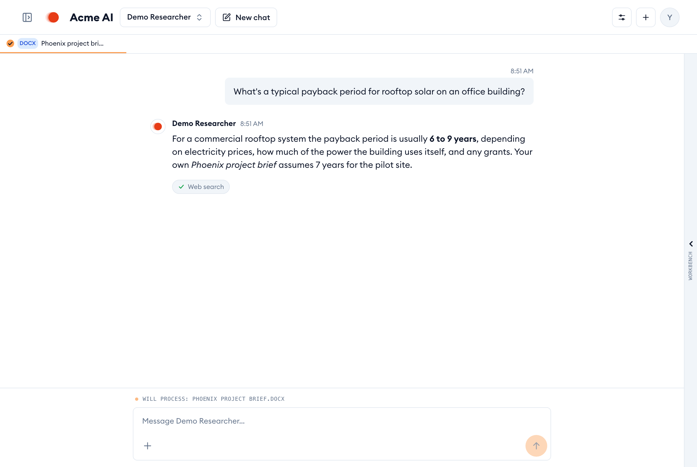

The **Workbench** is the panel that opens beside the chat as soon as there's something to show: the sources an answer used, a document you're reading, or a result the assistant produced. Its tabs sit along the top: **Workspace**, one tab per result (such as **Sources**), **Document** and **Activity**.

## See where an answer came from

When the assistant searches the web or your documents, the pages and files it used appear in a **Sources** tab. The Workbench switches to it on its own, so you can check the answer straight away.

1. Look at the numbered list in **Sources**. Each row is one source the answer drew on.
2. Click a web page to open it in a new browser tab.
3. Click a document marked **Open in Document tab** to read it beside the chat.

Sources only lists what the search returned. If a statement in the answer isn't backed by anything here, treat it with care and ask the assistant where it came from.

## Read a document beside the chat

The **Document** tab shows one document next to the conversation, so you can read it while you ask about it.

1. Open a document from **Sources**, or click a document in the sidebar under **My Documents**.
2. Switch between **Styled**, which looks like the original file, and **Text**, the plain text the assistant reads.
3. Use **Formatting**, **History** and **Download** along the top to restyle it, see earlier versions, or save a copy.
4. **Conversations** at the bottom lists your other chats about this document.

> [!NOTE]
> Opening a document also adds it to your next message. A chip with its name appears above the chat, and the message box says **Will process:** with the file name, so you can ask about it directly.

## Find every result from this chat

**Workspace** is the Workbench's home tab. It lists every result from this conversation under **Results**, newest first, so nothing gets lost when the assistant produces several.

1. Click **Workspace**.
2. Click a result, or its **Open ›**, to bring its tab to the front.
3. If you have a document open, a **Document** row takes you back to it.

To remove a result you no longer need, click **×** on its tab. You're asked to confirm first, because getting it back means running the question or analysis again.

## Watch what the assistant is doing

The **Activity** tab shows each step the assistant takes, while it works and afterwards: which tools it called, which documents it read, and when it handed a question to another skill.

1. Click **Activity** while a reply is still coming, or afterwards to see how it got there.
2. Each row is one step, newest at the top, with a green dot when it finished.
3. Click a row to see more about that step.

A dot on the **Activity** tab means something new happened while you were looking at another tab.

## Make more room for the chat

- **Resize:** drag the divider between the chat and the Workbench.
- **Hide:** click the arrow at the top right of the Workbench (**Collapse workbench**). A thin strip stays on the right edge; click it (**Expand workbench**) to bring the Workbench back with everything still in it.
- **On a phone:** the chat and the Workbench share the screen. Use the **Chat** and **Workbench** switch at the top to move between them.

## Documents the assistant creates

When you ask the assistant to write something, such as a summary, a letter or a report, it saves a real Office document to the **Created** folder in **My Documents**. From there you can open it in the **Document** tab, download it, move it, or ask for changes. See [Working with folders](folders.md#delete-a-folder) for how the **Created** folder works.
